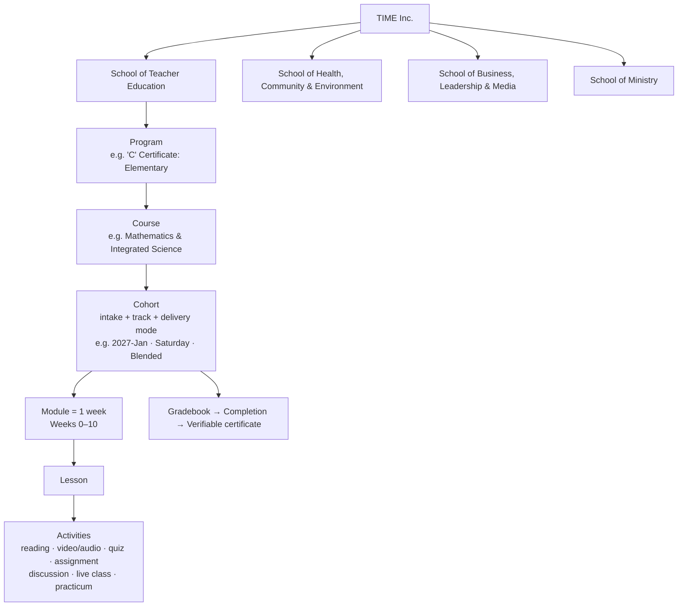
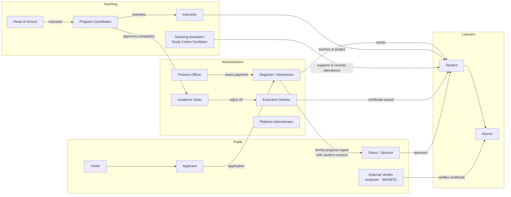
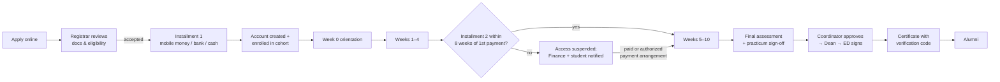

# TIME Inc. — Online Learning Structure & Role Map

Draft blueprint · 29 Oct 2026 · Builds on `docs/platform-review-recommendations.md` (P1 and P5)

This document sets out how TIME Inc. can move from a brochure website to a **blended learning platform**. It covers how learning is organised (§1), who does what (§2–3), how a student moves through the system (§4), the technology (§5), how the public website changes (§6) and the build order, with prompts for Claude Code (§7).

Items marked **[Decide]** need a decision from TIME leadership.

---

## 1. Learning structure

### 1.1 Hierarchy

| Level | What it is | Owned by |
|---|---|---|
| **School** | A group of related programs | Head of School |
| **Program** | The award a student enrols for (certificate or diploma) | Program Coordinator |
| **Course** | One subject or unit inside a program. It's the reusable "master" copy of the content. | Lead Instructor |
| **Cohort** | One running of a course: an intake date, a track (Weekday or Saturday) and a delivery mode | Registrar opens it; Instructor teaches it |
| **Module** | One week of learning | Instructor |
| **Lesson / Activity** | The individual learning pieces | Instructor |

**Why the Course and the Cohort are separate:** content is written once and reused for every intake. Grades, attendance and payments belong to the cohort.

### 1.2 Proposed schools (mapping the 33 course entries on `programs.html`) **[Decide]**

| School | Programs and courses (from `programs.html`) |
|---|---|
| **Teacher Education** | "C" Certificate Elementary (4 specialisations) · "C" Certificate Senior High Science Lab (Physics, Chemistry, Mathematics, Biology, Economics) · Phonics Education · School Leadership & Management · School Finance · School-Based Recordkeeping · English Grammar & Composition · Research Skills |
| **Health, Community & Environment** | Substance Abuse Prevention · IPC Education · Emergency Community Education · Community Surveillance & Reporting · Community Health Facility Mgmt · Guidance & Psychosocial Counseling · Community Health & Engagement · GIS for Environmental Mapping · Environmental Health & Safety · Drugstore Operations |
| **Business, Leadership & Media** | QuickBooks · Monitoring & Evaluation · Internal Auditing · Professional Journalism · Gender & Peace Studies · Professional Ethics |
| **Ministry** | Biblical Interpretation, Greek I & II · Church Leadership & Administration |

### 1.3 Delivery modes

**Decided (31 Oct 2026):** courses are offered **online or blended**. Each course's mode is set by its learning outcomes, practical requirements and student needs. The suggestions below are proposals until each course is confirmed.

| Mode | Description | Suggested for |
|---|---|---|
| **Blended** | Weekly online lessons plus scheduled face-to-face sessions at the Margibi campus or a county study centre | "C" Certificates (teaching practicum), Senior High Science Lab (lab work), most health and community courses |
| **Online** | Fully online with live sessions, online quizzes and a final assessment | QuickBooks, M&E, Research Skills, Professional Ethics, Journalism, Greek I & II |

**Connectivity rule:** every online lesson must work on a phone with prepaid data. Use text and PDF first, audio second and short compressed video third. Make lessons downloadable for offline study, and record live classes for anyone who misses them.

### 1.4 Standard 10-week course template

**Grading (decided 31 Oct 2026, pending formal approval):** 100 points per course.

| Component | Points | Where it falls |
|---|---|---|
| Continuous assessment (weekly quizzes, discussions, participation) | 30 | Weeks 1–10 |
| Assignments & practical activities | 20 | Weeks 3, 8 (+ practicum/lab work) |
| Midterm examination or assessment | 20 | Week 5 |
| Final examination or course project | 30 | Week 10 |

| Week | Content | Assessment |
|---|---|---|
| 0 | Orientation: how to use the platform, course outline, meet the instructor | Platform check quiz (ungraded) |
| 1–4 | Modules 1–4 | Weekly quizzes & discussions · Assignment 1 (week 3) |
| 5 | Module 5 · mid-course check-in | **Midterm** |
| 6–9 | Modules 6–9 | Weekly quizzes & discussions · Assignment 2 (week 8) |
| 10 | Review · practicum/lab sign-off where required | **Final exam or project** |

**Completion rule:** a total of at least **70/100**, all required assessments completed, any course-specific requirements met (e.g. teaching practicum, lab work), and fees cleared.

**Payment rule (decided):** the 2nd installment is due **8 weeks after the date of the first payment**. The due date is given to the student in writing at registration. If it isn't paid by then, access to the platform and course materials is **temporarily suspended**. Access returns when the balance is paid or an authorized payment arrangement is approved. Students get reminders 2 weeks and 3 days before the deadline.

---

## 2. Role map

### 2.1 Role definitions

| # | Role | Who at TIME (example) | Core responsibilities |
|---|---|---|---|
| 1 | **Visitor** | Anyone | Browse the catalogue, read news, contact TIME |
| 2 | **Applicant** | A prospective student | Apply online, upload documents, track application status |
| 3 | **Student** | Trainee teachers, professionals | Learn, submit work, see grades and attendance, pay fees, download certificate |
| 4 | **Alumni** | Graduates | Keep access to their certificate and transcript, take further courses, mentor |
| 5 | **Instructor** | TIME faculty | Build course content, teach cohorts, grade, take attendance, message students |
| 6 | **Teaching Assistant / Study Centre Facilitator** | Staff at the county study centres (locations to be confirmed) | Run face-to-face sessions, record attendance, give academic guidance and in-person help, observe teaching practicum |
| 7 | **Program Coordinator** | One per program | Assign instructors, review grades, approve completion, handle appeals |
| 8 | **Head of School** | One per school | Approve new courses and curricula, check quality across programs |
| 9 | **Registrar / Admissions** | Admissions office (the 4 admissions lines) | Review applications, enrol students in cohorts, keep records, issue transcripts |
| 10 | **Finance Officer** | Bursar | Record installments (cash, mobile money, bank), track the 8-week balance deadline, suspend or restore access, approve payment arrangements, record sponsorships |
| 11 | **Academic Dean** | Senior academic | Academic calendar, assessment policy, final grade approval |
| 12 | **Executive Director** | Dr. Saywrayne | Sign certificates, view dashboards, reports for MoE/BTE |
| 13 | **Platform Administrator** | IT lead | Accounts, roles, backups, integrations, security |
| 14 | **Donor / Sponsor** | Individuals, churches, NGOs | Sponsor a student; with the student's informed consent, receive a summarized progress report at the end of each term (or at agreed intervals). No platform login is needed. |
| 15 | **External Verifier** | Employers, MoE, Bureau of Teacher Education | Look up a certificate by its code (no login needed) |

> **Later (PHICA phase):** PHICA Principal, PHICA Teacher and Parent/Guardian roles could reuse the same platform for report cards and parent communication. This is out of scope for phase 1.

One person can hold several roles. For example, Dr. Saywrayne can be Executive Director *and* an Instructor. The rule is that permissions come from the role, not from who the person is.

---

## 3. Permissions matrix

C = create · R = read · U = update · D = delete · A = approve · — = no access · "own" = only their own records/cohorts

| Capability | Stu | Inst | TA/Centre | Coord | Head | Reg | Fin | Dean | ED | Admin | Sponsor |
|---|---|---|---|---|---|---|---|---|---|---|---|
| View course content | R (enrolled) | R | R (own) | R | R | — | — | R | R | R | — |
| Build/edit course content | — | CRU (own) | — | RU | A | — | — | R | — | CRUD | — |
| Open a cohort / set dates | — | — | — | C | — | CU | — | A | — | CRUD | — |
| Enrol / withdraw students | — | — | — | R | — | CRUD | — | R | R | CRUD | — |
| Submit work / take quizzes | C (own) | — | — | — | — | — | — | — | — | — | — |
| Grade work | R (own) | CRU (own) | R | RU | R | R | — | A | R | R | — |
| Record attendance | R (own) | CRU (own) | CRU (own) | R | R | R | — | R | R | R | — |
| Approve completion | — | — | — | A | — | R | R | A | R | — | — |
| Record payments | R (own) | — | — | — | — | R | CRU | — | R | R | — |
| Suspend/restore access for unpaid balance | — | — | — | — | — | R | U | — | — | U | — |
| Approve a payment arrangement | — | — | — | — | — | R | A | — | A | — | — |
| Issue / revoke certificate | R (own) | — | — | — | — | C | — | A | A (sign) | U | — |
| Message students | R/C (own) | C (own) | C (own) | C | C | C | C | C | C | C | — |
| View reports & dashboards | — | own cohorts | — | program | school | enrolment | finance | all | all | all | — |
| Prepare / receive sponsor progress report | — | — | — | R | — | C | R | R | A | — | R (termly, consented) |
| Manage users & roles | — | — | — | — | — | C (students) | — | — | — | CRUD | — |

**Privacy rules:**
- **Sponsors (decided 31 Oct 2026):** with the student's informed consent, the Registrar sends a summarized report at the end of each term or at agreed intervals. It covers enrolment status, attendance/participation, assignment completion, assessment results or overall grades, academic standing and completion status. It never includes individual assignments, detailed academic records, personal communications or other confidential information without proper authorization. Template: `lms/sponsor-report-template.md`.
- An external verifier sees only the name, program, year and status that belong to a valid certificate code.

---

## 4. Student lifecycle

Notifications at each step go by **SMS/WhatsApp first and email second**, since many students won't check email often.

---

## 5. Recommended technology

| Layer | Recommendation | Why |
|---|---|---|
| Public website | Keep the current static site on GitHub Pages | Fast, free, already built |
| **Learning platform (LMS)** | **Moodle**, hosted on MoodleCloud or a small VPS **[Decide hosting]** | Open source and widely used by African universities. Has built-in roles that map to §2, cohorts, gradebook, attendance, an offline mobile app (download lessons, sync later), and certificates with verification codes (`mod_customcert` plugin). |
| Applications | Moodle self-registration with approval, or Formspree/Tally, then a CSV import | Start simple |
| Payments | Recorded by Finance in Moodle (custom profile field or the enrol fee plugin). Orange Money / MTN MoMo are logged manually at first. | Mobile money APIs can be added later |
| Live classes | Google Meet or Zoom (link inside each Moodle module); BigBlueButton later | Low setup cost |
| Messaging | WhatsApp groups per cohort plus Moodle notifications | Matches how students already communicate |

*Alternative considered:* Google Classroom. It's free and simple, but it has no proper registrar, finance or completion roles, no certificates and no reporting. It's fine for a pilot, but TIME would outgrow it in a year.

### 5.1 Mapping TIME roles to Moodle roles

| TIME role | Moodle role (context) |
|---|---|
| Student | Student (course) |
| Instructor | Teacher (course) |
| TA / Study Centre Facilitator | Non-editing teacher (course) |
| Program Coordinator | Manager (program category) |
| Head of School | Manager (school category) |
| Registrar | Custom "Registrar" role (system): enrol, users, cohorts, certificates |
| Finance Officer | Custom "Finance" role (system): payment fields, suspend/reactivate enrolment |
| Academic Dean / ED | Custom "Academic leadership" role: read everything, approve grades and certificates |
| Platform Administrator | Site administrator |
| Sponsor | No Moodle account; receives the termly report prepared by the Registrar |
| External Verifier | No account; uses the public certificate verification page |

Moodle **course categories** = Schools → Programs. Moodle **courses** = one per Cohort (copied from a master course). Moodle **cohorts** = intake groups.

---

## 6. Changes to the public website

1. **Main nav:** Home · About · **Programs** · **Online Learning** · Phìtìa Academy · Impact · Contact · *Student Login* (top bar) · *Support Us* (button).
2. **New `online-learning.html`:** how blended learning works, delivery modes, device and data requirements, the 10-week structure, "first week" walkthrough, offline app, county study centres ("locations will be published once confirmed"), FAQ.
3. **Course catalogue** (`courses.json`, from review item #6): add `school`, `program`, `delivery_modes[]`, `next_cohorts[]` (date, track, mode, seats) and `lms_course_url`. Show badges for delivery mode.
4. **Verify page:** links to Moodle's certificate verification (or reads a JSON export).
5. **"Our team" page:** generated from a `staff.json` file, using the roles in §2 (Heads of School, Coordinators, Registrar, faculty).

---

## 7. Build plan and prompts for Claude Code

### Phase 1: Structure the data (this repo)

> **Prompt 1 — Catalogue data model:** Create `assets/data/catalogue.json` with the hierarchy `schools[] → programs[] → courses[]`, using the grouping in `docs/online-learning-blueprint.md` §1.2 and the 33 course entries currently on `programs.html`. Each course needs: `id` (slug), `title`, `school_id`, `program_id`, `summary`, `who_for`, `outcomes[]`, `entry_requirements`, `duration_weeks` (10), `delivery_modes[]` (from §1.3), `fee`, `installments` (2), `certificate_awarded`, `next_cohorts[]` (`{start_date, track: weekday|saturday, mode, seats}`), `lms_course_url`. Use `"TODO"` for unknown values. Re-render the tabs on `programs.html` from this file, grouped by School then Program, and show delivery-mode badges. Keep the existing search, keyboard tabs and a `<noscript>` fallback list.

> **Prompt 2 — Online Learning page:** Create `online-learning.html` using the existing page template (header, page-hero, page-links, footer, action bar). Sections: How blended learning works (the online and blended modes as cards); A 10-week course at a glance (the table from §1.4); What you need (phone or computer, data estimate per week, the Moodle app for offline study); County study centres ("locations will be published once confirmed"); Student journey (the steps from §4 as a numbered timeline); FAQ in `
`. Add it to the nav on every page, the footer, the sitemap, and add a "Student Login" link in the top bar pointing at `TODO_LMS_URL`.

> **Prompt 3 — Roles page:** Create `assets/data/staff.json` (name, role from §2.1, school, photo, short bio) and a "Our people" section on `about.html` that renders leadership, Heads of School, Program Coordinators, Registrar and faculty from it. Use the 3 existing co-founders and TODO placeholders for the others.

### Phase 2: Set up the LMS (generated in this repo, imported into Moodle)

> **Prompt 4 — Moodle import files:** Create `lms/` containing Moodle bulk-upload CSVs generated from `assets/data/catalogue.json` by a script `lms/build-moodle-csv.mjs`: (a) `categories.csv` (Schools → Programs); (b) `courses.csv` in Moodle's "Upload courses" format, one master course per catalogue course (shortname = `MASTER-<id>`, format = weeks, numsections = 11 for weeks 0–10); (c) `cohorts.csv` for each `next_cohorts` entry (idnumber `<id>-<start_date>-<track>`). Add `lms/README.md` explaining the import order and the custom roles to create (Registrar, Finance, Academic leadership) with the capabilities listed in §3 and §5.1.

> **Prompt 5 — Course shell template:** Create `lms/course-template.md`, a standard 10-week Moodle course layout from §1.4: Week 0 orientation items, and for each week a lesson page, downloadable PDF slot, quiz, discussion forum and live-class link, plus the gradebook categories and weights. Write it so an instructor can follow it when filling in a master course.

### Phase 3: Connect the two

> **Prompt 6 — Certificate verification:** Create `verify.html`. A form takes a certificate code and redirects to the Moodle `mod_customcert` verification URL (`TODO_LMS_URL/mod/customcert/verify_certificate.php?code=...`). Explain what the verifier will see, and offer a "contact the Registrar" fallback. Link it from the footer and from `programs.html`.

> **Prompt 7 — Application form:** On `programs.html#register`, add an online application form whose course dropdown and cohort/track options are read from `catalogue.json` `next_cohorts`. Submit to `TODO_FORM_ENDPOINT`. After submitting, show the next steps from §4 (Registrar review → installment 1 → account created).

---

## 8. Decisions

**Decided 31 Oct 2026**

| # | Question | Decision |
|---|---|---|
| 2 | Delivery modes | Online and blended only; set per course by learning outcomes, practical needs and student needs (§1.3) |
| 3 | Grading and pass mark | 100 points: continuous assessment 30, assignments & practicals 20, midterm 20, final 30. Pass mark **70%**. To be formally approved and applied consistently (§1.4). |
| 4 | Second installment | Due 8 weeks from the first payment; access suspended if unpaid, restored on payment or an authorized payment arrangement; policy communicated at registration (§1.4) |
| 6 | County study centres | To be set up in the target counties once approved, with suitable facilities and operational readiness; locations published once confirmed |
| 7 | Sponsor information | Summarized termly (or agreed-interval) reports with the student's informed consent; no confidential detail (§3) |
| 8 | Scope of these rules | They apply to **all TIME courses** (certificates and diplomas), not only postgraduate ones (confirmed 31 Oct 2026) |

**Still open**

1. Is the school grouping in §1.2 right, and who are the Heads of School and Program Coordinators?
2. The confirmed delivery mode for each course (`delivery_modes` in `catalogue.json` is still a proposal).
3. Moodle hosting (MoodleCloud plan or VPS) and the LMS web address, e.g. `learn.time-liberia.com`.
4. Study centre locations, contacts and facilitators.

---

## 9. Progress

| Item | Status |
|---|---|
| Prompt 1: course catalogue data | **Data file done** (`assets/data/catalogue.json`, all 33 entries). Rendering `programs.html` from it waits for the decisions in §8. |
| Prompt 4: Moodle import files | **Done** (`lms/build-moodle-csv.mjs`, `lms/out/*.csv`, `lms/README.md`) |
| Prompt 5: course shell template | **Done** (`lms/course-template.md`) |
| Decisions of 31 Oct 2026 | **Applied** to this blueprint, `catalogue.json` (policies, delivery modes), `lms/course-template.md`, `lms/README.md` and the new `lms/sponsor-report-template.md` |
| Prompts 2, 3, 6, 7 | Waiting on the LMS address, staff list and the open items in §8 |
